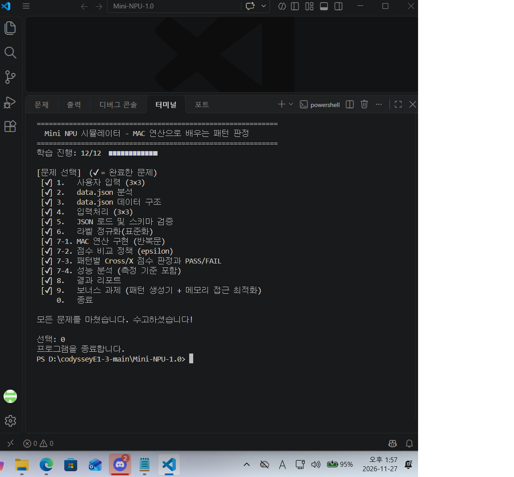

# Mini NPU 시뮬레이터 - MAC 연산으로 배우는 패턴 판정

필터(Filter)와 패턴(Pattern)의 **MAC(Multiply-Accumulate) 점수**를 비교해서 패턴이 십자가(Cross)인지 X인지 판정하는 콘솔 프로그램입니다.
외부 라이브러리(NumPy 등) 없이 **반복문으로 직접** 구현했고, 문제별로 `핵심 설명 → 문제 내용 → 실행 결과 → 코딩 내용` 순서로 보여 주는 학습용 메뉴로 구성했습니다.

## 파일 구성

| 파일 | 설명 |
|------|------|
| `main10.py` | 메인 실행 파일 (모든 기능이 이 파일 하나에 들어 있습니다) |
| `data.json` | 필터와 패턴 데이터 (`main.py`와 같은 폴더에 둡니다) |
| `README.md` | 실행 방법, 구현 요약, 결과 리포트, 재현성 |

## 1. 실행 방법

### 준비

- Python 3.8 이상 (외부 패키지 설치 없음)
- `main10.py`와 `data.json`을 **같은 폴더**에 둡니다. (`data.json`은 `main.py`가 있는 폴더에서 읽습니다. 실행 위치가 달라도 상관없습니다.)

### 실행
```
python main10.py
```
### 메뉴 화면 캡쳐

     

### 메뉴 선택 방법

실행하면 제목과 학습 진행 현황, 문제 목록이 나옵니다. 번호를 입력하고 Enter를 누르면 해당 문제로 들어가고, 문제가 끝나면 Enter로 메뉴로 돌아옵니다. 문제를 끝까지 마치면 번호 옆에 `[✔]`가 표시되고 진행 현황이 올라갑니다. `0`을 입력하면 종료합니다.

| 번호 | 내용 | 과제 요구서의 모드/항목 |
|------|------|------------------------|
| 1 | 사용자 입력 (3×3) | **모드 1** |
| 2 | data.json 분석 | **모드 2** |
| 3 | data.json 데이터 구조 | 데이터 구조 확인 |
| 4 | 입력처리 (3×3) | 입력 검증 연습 |
| 5 | JSON 로드 및 스키마 검증 | 스키마 검증 |
| 6 | 라벨 정규화(표준화) | 라벨 정규화 |
| 7-1 | MAC 연산 구현 (반복문) | 7-1 |
| 7-2 | 점수 비교 정책 (epsilon) | 7-2 |
| 7-3 | 패턴별 Cross/X 점수 판정과 PASS/FAIL | 7-3 |
| 7-4 | 성능 분석 (측정 기준 포함) | 7-4 |
| 8 | 결과 리포트 | 결과 리포트 (전체/통과/실패 + 실패 목록) |
| 9 | 보너스 과제 | 패턴 생성기 + 1차원 변환 성능 비교 |
| 0 | 종료 | |

### data.json 위치와 구조

`main.py`와 같은 폴더의 `data.json`을 읽습니다. 구조는 다음과 같습니다.

```text
{
  "filters":  { "size_5": {"cross": [[...]], "x": [[...]]}, "size_13": {...}, "size_25": {...} },
  "patterns": { "size_5_1": {"input": [[...]], "expected": "+"}, "size_13_1": {...}, ... }
}
```

- 필터는 `size_N` 키 아래에 두 개(Cross, X)가 있고, 패턴은 `size_N_번호` 키로 케이스를 구분합니다.
- 패턴 키에서 크기 N을 뽑아 같은 크기의 필터를 선택합니다.

## 2. 구현 요약

### 라벨 정규화

프로그램 내부에서는 표준 라벨 **`Cross`, `X` 두 가지만** 사용합니다.

- `normalize_label()`: 문자열의 앞뒤 공백을 지우고 소문자로 맞춘(`strip().casefold()`) 뒤 `"cross"`, `"+"` → `Cross`, `"x"` → `X`로 바꿉니다. 그 밖의 값은 변환 불가(`None`)로 처리합니다.
- `expected` 값(`"+"`, `"x"`)과 필터 키(`"cross"`, `"x"`)를 모두 이 규칙으로 표준화한 뒤 비교하므로, 대소문자나 표기가 달라도 같은 라벨로 취급합니다.
- 필터 묶음에서 표준 라벨이 중복되거나 Cross/X 중 하나가 없으면 그 크기의 필터는 사용할 수 없는 것으로 처리합니다. 변환할 수 없는 `expected`는 그 케이스만 FAIL로 처리합니다.
- 콘솔 출력과 PASS/FAIL 비교는 모두 표준 라벨(Cross/X) 기준입니다.

### MAC 연산 구현 개요

`mac(pattern, filter_matrix)`는 이중 반복문으로 같은 위치의 값을 곱해 모두 더하고, 점수를 `float`로 반환합니다.

```text
score = Σ (pattern[row][column] × filter[row][column])    (row, column = 0 ~ N-1)
```

- 계산 전에 `validate_matrix()`로 행렬의 크기(N×N), 값이 숫자인지(bool 제외), 유한한 값인지(NaN/무한대 제외)를 검사합니다.
- 값에 접근할 때는 `get_matrix_value()`/`set_matrix_value()`를 거치며 위치 범위도 검사합니다.
- 오류가 있으면 `ValueError`를 발생시키고, 호출한 쪽이 케이스 단위로 처리합니다.

### 동점 처리 정책 (epsilon)

부동소수점 계산에는 아주 작은 오차가 생길 수 있습니다. 예를 들어 `0.1 + 0.2 == 0.3`은 `False`입니다. 그래서 점수를 `==`로 비교하지 않고 **허용오차(epsilon) 기반**으로 비교합니다.

```text
abs(score_a - score_b) < EPSILON (= 1e-9)  →  동점, 판정 "UNDECIDED"
그 외                                       →  점수가 높은 쪽으로 판정 (Cross / X)
```

- `UNDECIDED`는 `expected`(Cross 또는 X)와 같을 수 없으므로 FAIL로 집계하고, 실패 사유에 "동점(UNDECIDED) 처리 규칙"이라고 남깁니다.

### 오류 처리 방침

| 상황 | 처리 |
|------|------|
| 모드 1 입력 (행/열 개수 불일치, 숫자가 아닌 값) | 오류 안내 후 해당 행렬을 **다시 입력**하도록 유도 |
| 모드 2 데이터 (스키마/크기 불일치, 라벨 변환 불가 등) | 프로그램을 멈추지 않고 **해당 케이스만 FAIL** 처리, 나머지 케이스는 계속 검사 |
| `data.json` 없음/JSON 형식 오류 | `실행 오류: ...`를 출력하고 메뉴로 돌아옴 (체크 표시는 붙지 않음) |

## 3. 결과 리포트

### 3-1. 실행 결과 요약 (모드 2, 제출용 `data.json` 기준)

> **총 테스트 __개 / 통과 __개 / 실패 __개**
> (`python main.py` → `2` 또는 `8`을 실행했을 때 마지막에 나오는 `결과 요약`의 값을 적습니다.)

### 3-2. FAIL 케이스 원인 분석

이 프로그램에서 FAIL이 생길 수 있는 원인은 크게 네 가지이고, 각각 대응 방법이 정해져 있습니다.

| 원인 분류 | 예시 | 프로그램의 대응 |
|-----------|------|----------------|
| ① 라벨 표기 | `expected`가 `"+"`, `"x"`, `"Cross"`처럼 제각각이거나 `"?"` 같은 알 수 없는 값 | 표준 라벨로 정규화해서 비교. 변환 불가이면 그 케이스만 FAIL(`expected 라벨을 Cross 또는 X로 변환할 수 없습니다.`) |
| ② 스키마/크기 | 패턴 행 수가 N이 아님, 열 개수 불일치, `size_N` 필터 없음, 키 형식이 `size_N_번호`가 아님 | `validate_matrix()`가 검사해서 그 케이스만 FAIL(`행렬 크기 불일치: 예상 5x5, 실제 4행입니다.`) |
| ③ 부동소수점 | 점수가 `0.1+0.2` 와 `0.3`처럼 사실상 같은 값인데 오차 때문에 다르게 보임 | `==` 대신 `abs(a-b) < 1e-9`로 비교해 오차를 흡수 |
| ④ 비교 정책(동점) | Cross 점수와 X 점수가 같아 어느 쪽이라고 정할 수 없음 | `UNDECIDED`로 판정하고 FAIL로 집계, 사유에 동점이라고 표시 |

**FAIL이 0이 되는 이유:** 판정 결과가 `expected`와 모두 같으려면 다음이 지켜져야 합니다. ⓐ 라벨 표기가 정규화되어 비교 기준이 같아졌다(①). ⓑ 모든 행렬이 크기 검사를 통과했다(②). ⓒ 점수 비교가 epsilon 기반이라 부동소수점 오차 때문에 판정이 흔들리지 않았다(③). ⓓ 각 패턴이 자기와 같은 모양의 필터에서 더 높은 점수를 받았다. 즉 정규화와 epsilon 정책이 "비교하는 방법"의 오류를 없애 주기 때문에, 남는 FAIL은 데이터나 판정 규칙 자체의 문제뿐입니다. 만약 FAIL이 남는다면 `실패 케이스:` 목록에 나오는 **케이스 식별자와 사유**를 보고 위 표의 어느 분류인지 확인하면 됩니다. 사유가 `판정 ... / expected ... 불일치`라면 데이터의 `expected`와 필터가 서로 맞지 않는 경우이고, `동점(UNDECIDED)`이라면 두 필터 점수가 같은 경우입니다.

### 3-3. 성능 표 해석과 시간 복잡도 분석

문제 7-4(또는 9)에서 크기별로 `mac()`을 10회 반복해 평균을 낸 결과입니다. 패턴과 필터를 만드는 시간과 입출력은 제외하고, `mac()` 호출 구간만 쟀습니다.

| 크기 (N×N) | 평균 시간 (ms) | 연산 횟수 (N²) | 1회당 시간 (µs) |
|-----------|---------------|---------------|----------------|
| 3×3 | 0.013 | 9 | 1.45 |
| 5×5 | 0.017 | 25 | 0.69 |
| 13×13 | 0.169 | 169 | 1.00 |
| 25×25 | 0.621 | 625 | 0.99 |

> 위 값은 작성 시 측정한 **예시**이며, PC와 실행 시점에 따라 달라집니다. 제출 전에 직접 실행한 값으로 바꿔 쓰세요.

- **연산 횟수:** `mac()`은 N×N칸을 한 칸씩 곱해 더하므로 곱셈-덧셈이 정확히 **N²번**입니다. 크기가 5 → 13 → 25로 커지면 연산 횟수는 25 → 169 → 625로 늘어납니다.
- **측정 결과와의 연결:** 13×13에서 25×25로 갈 때 연산 횟수는 약 3.70배(625/169)이고, 측정 시간은 약 3.68배(0.621/0.169)로 거의 같이 늘었습니다. 연산 1회당 시간도 13×13과 25×25에서 약 1.0µs로 비슷합니다. 시간이 연산 횟수 N²에 비례한다는 뜻이므로 **O(N²)** 입니다.
- **작은 크기의 오차:** 3×3, 5×5는 시간이 너무 짧아서 함수 호출 같은 고정 시간과 측정 오차의 비중이 커 1회당 시간이 들쭉날쭉합니다. 그래서 크기가 큰 쪽(13×13, 25×25)이 복잡도를 확인하기에 더 적합합니다.
- **검사 시간도 O(N²):** `mac()`이 부르는 `validate_matrix()`도 모든 칸을 한 번씩 확인하므로 O(N²)입니다. 계산과 검사를 합쳐도 전체 복잡도는 O(N²)에서 변하지 않습니다.
- **data.json 전체:** 케이스가 K개이면 케이스마다 MAC을 2번(Cross, X) 하므로 전체는 **O(K·N²)** 입니다.
- **1차원 변환(보너스, 문제 9):** 2차원 배열을 길이 N²의 1차원 배열로 펴면 값 접근 방식이 단순해져서 같은 입력, 같은 10회 반복에서 시간이 줄어듭니다(측정 시 약 2~4배). 다만 연산 횟수는 여전히 N²이므로 **복잡도는 O(N²)로 같고 상수 시간만 줄어드는 최적화**입니다. 이 차이에는 접근 방식뿐 아니라 2D 쪽의 함수 호출/위치 검사 시간의 차이도 섞여 있습니다.

## 4. 재현성

### 모드 1: <br> 3×3 십자가 필터와 X 필터 입력

`python main.py` → `1`을 입력하고 아래처럼 입력합니다. (필터 A = 십자가, 필터 B = X, 패턴 = 십자가)

```text
필터 A:  0 1 0 / 1 1 1 / 0 1 0
필터 B:  1 0 1 / 0 1 0 / 1 0 1
패턴:    0 1 0 / 1 1 1 / 0 1 0
```

예상 출력 (연산 시간은 PC마다 다릅니다):

```text
A 점수: 5.0
B 점수: 1.0
연산 시간(평균/10회): 0.019582 ms
판정: A
```

점수가 같은 두 행렬을 넣으면 `판정: 판정 불가 (동점)`이 출력됩니다.

### 모드 2: <br>data.json 분석

`python main.py` → `2`를 입력합니다. 각 케이스마다 `Cross 점수`, `X 점수`, `판정 | expected | PASS/FAIL`이 출력되고, 마지막에 `결과 요약`(총 테스트/통과/실패와 실패 케이스 목록)이 나옵니다. **통과 수 + 실패 수 = 총 테스트 수**가 항상 맞습니다. 문제 8(결과 리포트)을 실행하면 같은 숫자를 요약 형태로 볼 수 있습니다.

### 의도적 오류 입력 확인

- **모드 1, 행/열 개수 불일치:** <br>필터 A의 1행에 `0 1`처럼 숫자를 2개만 입력하면 3행까지 입력한 뒤 아래 안내가 나오고, 같은 행렬을 처음부터 다시 입력하게 합니다.

  ```text
  입력 형식 오류: 각 줄에 3개의 숫자를 공백으로 구분해 입력하세요.
  ```

- **모드 4  (입력처리):** <br>행 수, 행마다 숫자 개수, 숫자가 아닌 값을 모두 찾아 목록으로 안내하고, 다시 입력할지 묻습니다.
- **모드 2, 크기 불일치:** <br>`data.json`의 패턴 하나에서 행을 하나 지우고 실행하면 프로그램이 멈추지 않고 그 케이스만 FAIL로 처리됩니다.

  ```text
  판정: FAIL
  사유: 스키마/데이터 오류: 행렬 크기 불일치: 예상 5x5, 실제 4행입니다.
  ```

- **모드 2, 알 수 없는 expected:**<br> `expected`를 `"?"` 같은 값으로 바꾸면 `expected 라벨을 Cross 또는 X로 변환할 수 없습니다.`라는 사유로 그 케이스만 FAIL 처리됩니다. 마지막 `결과 요약`의 실패 케이스 목록에도 식별자와 사유가 함께 나옵니다.
